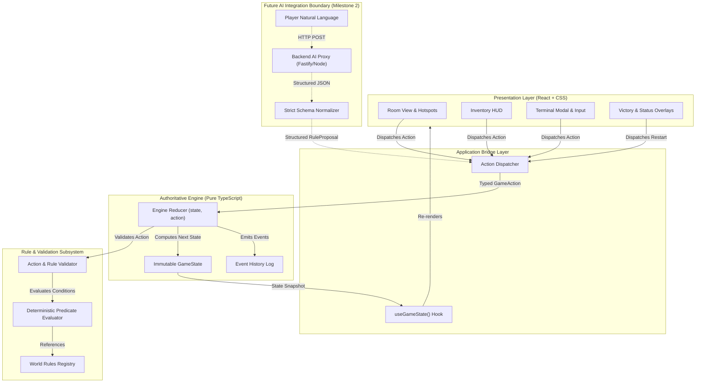
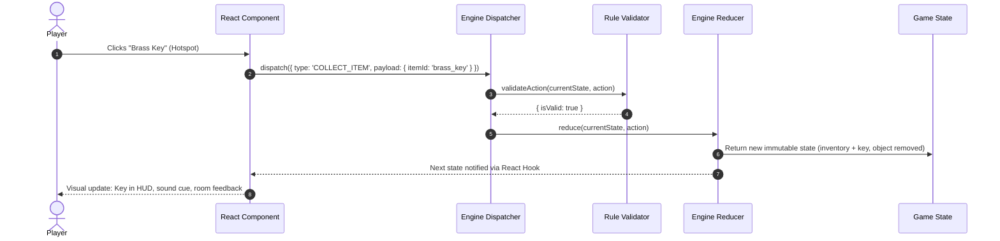
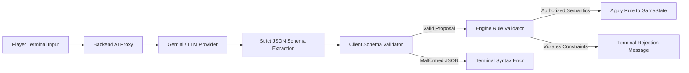

# ROOM S A — Architecture & System Design

> **Tagline:** *The room lies.*

---

## 1. Architectural Vision & Core Principles

**ROOM S A** is designed with a strict **unidirectional, deterministic, and decoupled** architecture. The core gameplay logic is completely isolated from the user interface and presentation layer.

### Core Principles

1. **Deterministic Authoritative Engine**: The game engine is a pure TypeScript state machine. Given a state $S$ and an action $A$, the reducer produces a deterministic next state $S'$ and a set of emitted events $E$.
2. **Immutable State Transitions**: State is never mutated in place. All collections and records are treated as readonly, preventing race conditions and simplifying state history and rewind capabilities.
3. **Strict Presentation Decoupling**: The engine has zero dependencies on React, the browser DOM, CSS, Canvas, or network APIs. It can be instantiated, simulated, and unit-tested in pure Node.js or Vitest without a DOM.
4. **Validation-First Action Dispatch**: React components cannot alter state directly. Components dispatch typed `GameAction` intents. The engine validates every action against world rules and current object states before committing changes.
5. **Fail-Closed Rule System**: World rules govern interaction legality. If an action or proposed rule does not pass strict schema and logical validation, it is rejected with descriptive failure telemetry.
6. **Sandboxed AI Proposal Pipeline**: Future AI features interpret natural language into structured proposals. The AI **never** mutates game state and **never** bypasses the validation gate.

---

## 2. Layered Architecture Diagram



---

## 3. Dependency Boundaries & Direction of Flow

The dependency graph is strictly **acyclic and unidirectional**:

```
[Presentation: React Components]
          │
          ▼ (imports types & hooks)
[App Layer: Hooks & Dispatcher]
          │
          ▼ (imports engine & types)
[Core Engine: State Reducer & Rules]
          │
          ▼ (imports types only)
[Domain Types & Predicates]
```

### Prohibited Dependencies
- ❌ **The Engine MUST NOT import React, ReactDOM, or JSX.**
- ❌ **The Engine MUST NOT access `window`, `document`, `localStorage`, or DOM APIs.**
- ❌ **The Engine MUST NOT import AI SDKs, HTTP clients, or API keys.**
- ❌ **React components MUST NOT mutate `GameState` properties directly.**

---

## 4. State Model & Action Dispatch Pipeline

### The GameState Shape
```typescript
export interface GameState {
  readonly currentRoomId: RoomId;
  readonly status: GameStatus;              // 'playing' | 'escaped' | 'failed'
  readonly inventory: readonly InventoryItem[];
  readonly objects: Readonly<Record<ObjectId, RoomObject>>;
  readonly exit: RoomExit;
  readonly rules: Readonly<Record<RuleId, WorldRule>>;
  readonly activeRuleIds: readonly RuleId[];
  readonly eventLog: readonly GameEvent[];
  readonly inspectedObjectIds: readonly ObjectId[];
  readonly terminalOpen: boolean;
  readonly terminalLog: readonly string[];
}
```

### The Action Dispatch Cycle



---

## 5. Rule System Architecture

The core premise of **ROOM S A** is: **The room lies.**

At any time, reality is governed by an active set of `WorldRule`s. Some rules are deceptive barriers planted to mislead the player.

### Rule Structure
```typescript
export interface WorldRule {
  readonly id: RuleId;
  readonly statement: string;            // e.g. "Doors yield only to copper keys."
  readonly isActive: boolean;
  readonly isDeceptive: boolean;         // true if this rule constitutes a room lie
  readonly affectedObjectId?: ObjectId;
  readonly predicateKey: string;         // Deterministic handler key e.g. "RULE_KEY_MATCH"
  readonly parameters?: Record<string, unknown>;
}
```

### Rule Evaluation Pipeline
When an action such as `ATTEMPT_EXIT` is dispatched:
1. The engine checks `exit.unlockConditionRuleId`.
2. The engine looks up the active `WorldRule`.
3. The engine invokes the registered deterministic predicate matching `predicateKey`.
4. If the predicate passes (e.g., inventory contains an accepted key according to the *active* rule), the door unlocks and triggers the victory sequence.
5. If the predicate fails, an atmospheric feedback event is logged (e.g., *"The door remains shut. The lock rejects the brass key: Rule #1 insists only copper keys are recognized."*).

---

## 6. Future AI Integration Boundary & Security Model

In Milestone 2, players will be able to type natural-language rule alterations into the terminal (e.g. *"Allow brass keys to unlock doors"* or *"Make the door consider brass as copper"*).

### Security Architecture



### Strict Isolation Rules:
1. **Zero Client Secrets**: No AI provider API keys exist in client code, bundles, or environment variables.
2. **Deterministic Fallback**: If offline or if the AI service fails, the terminal provides deterministic command suggestions / auto-completion for all required puzzle solutions.
3. **Double Validation**: The AI output is treated as untrusted input. It is parsed against a Zod / strict schema and then validated by the engine's rule constraints.
4. **No Direct Execution**: The AI cannot trigger arbitrary state changes (e.g., cannot directly emit `SET_STATUS_ESCAPED`); it can only propose changes to defined rule statements and predicates.
