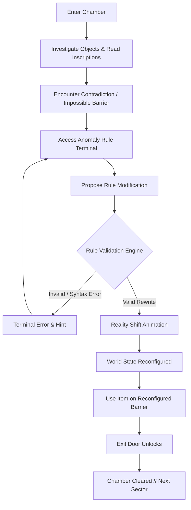

# ROOM S A — Game Design & Visual Specification

> **Tagline:** *The room lies.*

---

## 1. Game Concept & Narrative Premise

In **ROOM S A**, the player awakens inside a series of stark, architectural containment chambers. Each chamber is governed by a manifest set of physical and conceptual **World Rules**.

Unlike conventional escape rooms where the player merely searches for keys and hidden codes to satisfy the room's demands, **ROOM S A inverted the relationship**:

> **The laws of the room are not immutable physics. They are programmable constraints—and the room is actively lying to you.**

To escape, the player must:
1. Examine the room's physical objects and uncover latent contradictions.
2. Interrogate the stated rules governing the environment.
3. Access an anomaly terminal to rewrite the rule governing reality.
4. Observe visible environmental transformations as the room reconfigures.
5. Breach the exit.

---

## 2. Core Gameplay Loop



---

## 3. Milestone 1 Room Specification: "Chamber 101 — The First Lie"

### Narrative Context
Chamber 101 serves as the onboarding crucible. The player is confronted with a seemingly simple lock-and-key puzzle that is mathematically impossible under the room's default rules.

### Environment & Hotspots

| Hotspot / Entity | Default State | Visual Appearance | Interaction Behavior |
| :--- | :--- | :--- | :--- |
| **Blast Door** (`exit_door`) | Locked | Heavy titanium door with illuminated amber hydraulic latches and a plaque engraved: *"ONLY COPPER OPERATES THIS MECHANISM"*. | Clicking inspects the lock. Using Brass Key on it triggers failure: *"The lock remains rigid. The mechanism senses zinc in the alloy and rejects it."* |
| **Specimen Pedestal** (`pedestal`) | Uninspected | Polished dark slate plinth bathed in a vertical spotlight. | Inspecting reveals a heavy, finely milled brass key resting in an induction cradle. |
| **Brass Key** (`brass_key`) | Resting on pedestal | Warm golden alloy with numeric etching `#101`. | Clicking collects the key into player inventory. Inspecting provides: *"A machined brass key. Noticeably not copper."* |
| **Anomaly Terminal** (`terminal`) | Standby | Wall-recessed monochrome CRT with a soft amber phosphor glow and blinking cursor. | Clicking opens the Terminal modal. Displays active chamber laws: `RULE_01: "Doors yield only to copper keys."` |
| **Observation Slate** (`note`) | Pinned to wall | Magnetic slate with scratched handwriting. | Inspecting reads: *"The previous occupant spent months trying to transmute copper. They died without realizing the terminal console accepts rule overrides."* |

### The Contradiction & The Lie
- The player possesses a **Brass Key**.
- The room only provides a **Brass Key**; there is no copper key in existence.
- The door's lock is physically governed by `RULE_01`:
  $$\text{CanUnlock}(\text{door}, \text{key}) \iff \text{key.material} == \text{'copper'}$$
- The player must access the terminal and rewrite `RULE_01` to:
  $$\text{CanUnlock}(\text{door}, \text{key}) \iff \text{key.material} == \text{'brass'}$$

### The Environmental Transformation
Upon committing the validated rule:
1. The ambient room lighting pulses from harsh warning amber (`#d97706`) to a crisp resonant glow (`#fbbf24`).
2. An audible mechanical klaxon and hydraulic release shudder across the chamber frame.
3. The plaque text shifts: *"ALL ALLOY VARIANTS RECOGNIZED"*.
4. Interacting with the door with the brass key now successfully disengages the bolt.
5. The door slides open to white light, triggering the Victory screen.

---

## 4. Visual Art Direction & Aesthetic Guidelines

### Atmosphere & Tone
- **Austere Sci-Fi Brutalism**: Angular geometry, monolithic walls, exposed conduit panels, recessed lighting.
- **Lighting over Clutter**: Empty space feels intentional and atmospheric; dramatic point lights and soft radial glows.
- **Subtle Reality Distortion**: Scanlines, micro-vibrations, and chromatic aberration triggers during rule rewrites.
- **Zero Generic "Dashboard" Tropes**: No childish icons, no unnecessary gauges or graphs. The interface feels like an authentic research installation.

### Palette & Visual Tokens

| Token Name | Value | Purpose |
| :--- | :--- | :--- |
| `--color-bg-abyss` | `#07090c` | Deepest background; space outside the containment frame |
| `--color-bg-base` | `#0c0f14` | Primary room interior panels |
| `--color-bg-surface` | `#12161f` | Interactive consoles, modal frames, HUD containers |
| `--color-amber-primary`| `#f59e0b` | Primary interactive glyphs, active hotspots, alert status |
| `--color-amber-bright` | `#fbbf24` | Active cursors, rule highlights, key items |
| `--color-amber-glow`   | `rgba(245, 158, 11, 0.18)` | Ambient volumetric lighting and hotspot proximity halos |
| `--color-text-primary` | `#f3f4f6` | Muted ivory; high readability against charcoal |
| `--color-text-secondary`| `#c0c6d1` | Descriptive lore, object inspection subtitles |
| `--color-text-muted`   | `#788293` | Metadata, coordinates, inactive rules |

---

## 5. User Interface (HUD) Layout

```
+-------------------------------------------------------------------------+
| [ROOM S A] Chamber 101: The First Lie             [Rule: 1 Active]      |
+-------------------------------------------------------------------------+
|                                                                         |
|                                                                         |
|            [BLAST DOOR]                             [TERMINAL]          |
|            Status: LOCKED                           Status: ONLINE      |
|                                                                         |
|                                                                         |
|                        [SPECIMEN PEDESTAL]                              |
|                        Contains: [Brass Key]                            |
|                                                                         |
+-------------------------------------------------------------------------+
| INVENTORY: [Brass Key] [Empty] [Empty]             [EVENT LOG: Ready]   |
+-------------------------------------------------------------------------+
```

### Accessibility & Responsiveness
- **Keyboard Navigation**: Every hotspot, inventory slot, and terminal input is reachable via `Tab` with prominent amber focus rings (`outline: 2px solid var(--color-amber-bright)`).
- **ARIA Standards**: All interactive elements use `<button>` semantics with descriptive `aria-label`s.
- **Scalable Layout**: Uses CSS Grid with `aspect-ratio: 16 / 9` container scaling for high-DPI displays and desktop monitors, while gracefully stacking panels on tablets and mobile screens.
